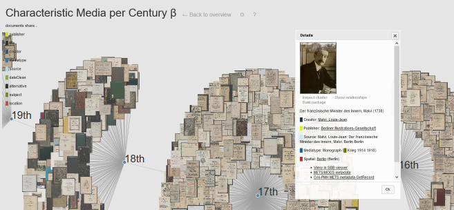
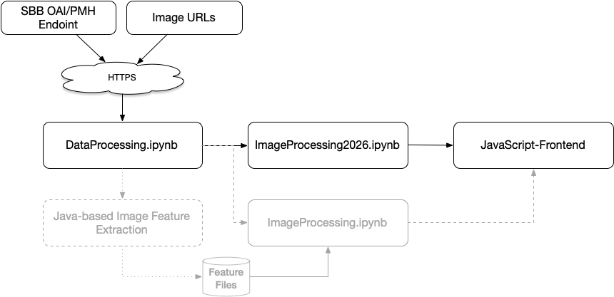

# SBBrowse2018 – Visualization of the Berlin State Library Digital Collections
#### Version: April/November 2026, but running smoothly since 2016



[Publication](https://link.springer.com/chapter/10.1007%2F978-3-319-43997-6_24)

Digital library (DL) support for different information seeking strategies (ISS) has not evolved as fast as their amount of offered stock or presentation quality. However, several studies argue for the support of explorative ISS in conjunction to the directed query-response paradigm. Hence, this paper presents a primarily explorative research system prototype for metadata harvesting allowing multimodal access to DL stock for researchers during the research idea development phase, i.e., while the information need (IN) is vague. To address evolving INs, the prototype also allows ISS transitions, e.g., to OPACs, if accuracy is needed.

As its second contribution, the paper presents a curated data set for digital humanities researchers that is automatically enriched with metadata derived by different algorithms including content-based image features. The automatic enrichment of originally bibliographic metadata is needed to support the exploration of large metadata stock as traditional metadata does not always address vague INs.

The presented proof of concept clearly shows that use case-specific metadata facilitates the interaction with large metadata corpora.

## Live Demo

To see the tool in action, follow this [link](https://8bit-inferno.de/force). The linked page also contains a short overview video.

## Installation 

From November 2026 on, the project now relies on [uv](https://github.com/astral-sh/uv) for package management. The enclosed [requirements.txt](./requirements.txt) is no longer updated.

### Historic Remarks

_As of November 2025 the HDF5 dependency has been removed. The following information has only been preserved for historic reasons._

The only known issues during the installation occur under macOS' ARM plattform are related to the build of the needed Python packages, i.e. _tables_ and _HDF5_.
The issues are described [here](https://github.com/PyTables/PyTables/issues/219) and [here](https://github.com/freqtrade/freqtrade/issues/4162#issuecomment-890377818) and basically boil down to running these commands before the pip-based installation using the provided _requirements.txt_: 
```
pip install cython
brew install hdf5
brew install c-blosc
export HDF5_DIR=/opt/homebrew/opt/hdf5 
export BLOSC_DIR=/opt/homebrew/opt/c-blosc
```
You might also have to add ``LZO_DIR`` and install LZO as seen aboved.

### Recommendation (November 2025, macOS with Mx-CPU)

To minimize your personal quest for finding _tables_-related errors, an installation of the latest _PyTables_ package directly from GitHub (typically) resolves all errors:

```
pip3 install git+https://github.com/PyTables/PyTables
````
Alternative installation paths are also [available](https://stackoverflow.com/questions/76780968/pytables-install-with-python-3-11-fails-on-macos-m1).

## How to Get Started



In 2016, SBBrowse was based on four distinct components:

1. [DataProcessing.ipynb](./DataProcessing.ipynb) handling the metadata record download from the Berlin State Library (SBB), its transformation into tabular data and the image download of title pages of each record. Additionally, this notebook cleans the retrieved data, augments it with geo locations and creates network graphs based on the automatically augmented data.
2. An image feature extraction in Java
3. [ImageProcessing.ipynb](./ImageProcessing.ipynb) clustering the image features and preparing the data for further visualizations.
4. A JavaScript-based frontend that allows the visual exploration of the data using [D3.js](https://github.com/d3/d3) and enabling information seeking transitions to other research tools such as the library catalog.

### Recommended Workflow

As of 2026, the Java feature extraction has been lost but as a good 'half-librarian' I might have lost a tool to create the data but not the the data itself: the so-called 'feature files'. Hence, it is still possible to follow most of the original workflow by using [ImageProcessing.ipynb](./ImageProcessing.ipynb) with the provided feature files. However, the old notebook is no longer maintained actively.

In order to use a more modern approach towards image similarity computations, a new notebook, [ImageProcessing2026.ipynb](./ImageProcessing2026.ipynb), is provided. It can be used to generate all needed data for the frontend.

In order to test the frontend, a web server is needed. To facilitate testing, [ImageProcessing2026.ipynb](./ImageProcessing2026.ipynb) (as well as the original version) comes with an embedded web server that can be launched on demand.

To use the current workflow you will have to run the following sequence:

1. [DataProcessing.ipynb](./DataProcessing.ipynb)
2. [ImageProcessing2026.ipynb](./ImageProcessing2026.ipynb)

Please see each notebook's documentation for further details. To get you started fast, each notebook supports the usage of sample data that is provided online as the image download and processing steps take a lot of time in particular.

## Further Reading

In case you want to check on other data offered by the SBB, you might be interested in [StabiHacks](https://github.com/elektrobohemian/StabiHacks).